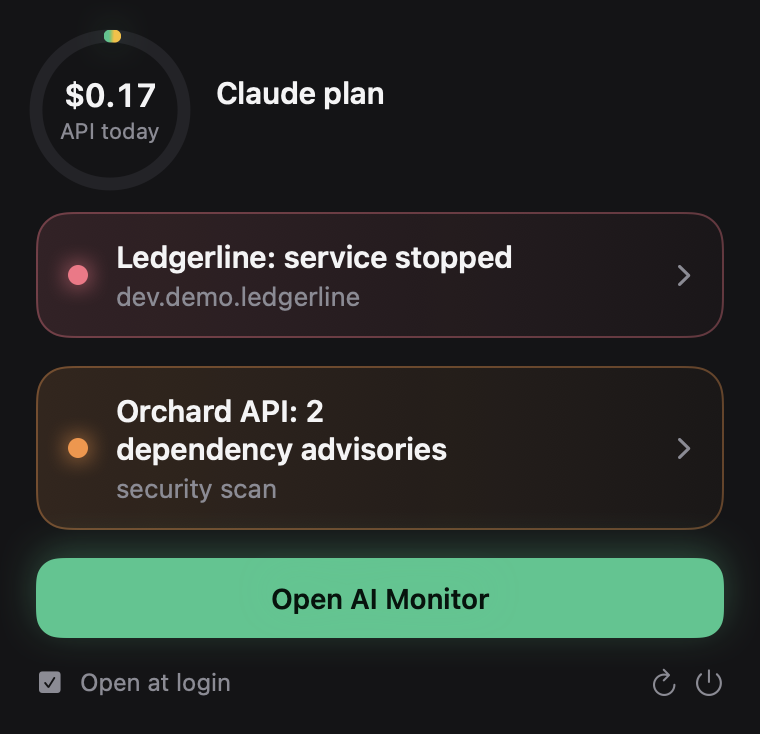

# AI Project Monitor

A macOS menu bar app for monitoring AI tooling on a Mac: model usage and cost, Claude Code sessions and tool calls, network traffic per process, and the state of local project repositories. It is meant for tracking cost, usage and traffic across different projects in a personal toolkit.

<p align="center">


</p>

## Features

There are four tabs.

- **Usage**: token counts and estimated API cost per project and per model, a daily and monthly spend chart, and Claude plan limits (5-hour session and weekly percentage). Optionally, Ollama cloud spend. Local models are counted as tokens only.
- **Trace**: Claude Code activity from its session logs. Tool calls in the last 24 hours with counts and failures, recent failures with the command or file involved, and recent sessions with duration, model calls, tool calls and failures.
- **Network**: outbound traffic per process, with open connections and remote hosts. AI-related processes are marked, and hosts that are not recognised are flagged. Hosts are resolved by reverse DNS, so entries are IP-level and not a full domain log.
- **Projects** (optional, shown only when Backtrail is installed): one row per repository of a Backtrail thread whose state is `moving`, with the LaunchAgents that belong to it and whether they run, the TCP ports its processes listen on, and unpushed or uncommitted work. A red dot is added to the menu bar item while a LaunchAgent that should be running is not.

## How it works

Usage comes from two sources:

1. **Claude Code.** Session logs in `~/.claude/projects` are read automatically. The project is the last folder of the working directory.
2. **The inbox.** Any other tool or application appends one JSON line per model call to a file in the inbox folder (see below).

Usage is stored in a local SQLite database, `~/Library/Application Support/aimon/aimon.db`. The Trace tab reads the same Claude Code logs. The Network tab samples `nettop` and `lsof` while the app runs.

The Projects tab reads `config.json` and `backtrail.db` (read-only) in `~/Library/Application Support/Backtrail`: the `repos` map gives each repository's folder and thread, and the thread state comes from the database. The tab is hidden when these files are absent. A LaunchAgent in `~/Library/LaunchAgents` belongs to a repository when its
working directory or program is inside it; only agents with `KeepAlive` are counted, since scheduled agents are idle most of the
time. A listening port belongs to a repository when the working directory of its process is inside it. Processes of other users
are not visible. The tab was checked on one Mac only.

## Requirements

- macOS 14 or later
- [Rust](https://rustup.rs)
- Swift toolchain (Xcode or the command line tools)

## Install

```
git clone <repository-url>
cd aimon
./build.sh        # builds the Rust core and the Swift app into AIMon.app
./install.sh      # installs a LaunchAgent: starts AI Project Monitor now and at login
```

`./uninstall.sh` stops AI Project Monitor and removes the LaunchAgent. The data folder is left in place.
Only one instance runs at a time; a second launch exits immediately.

## What AI Project Monitor reads and sends

- **Claude Code logs**: model name, token counts, timestamp and working folder of each call. Prompts and responses are not read.
- **Claude plan limits** (off by default): enable with the button in the Usage tab or `aimon config claude_limits on`.
  When enabled, AI Project Monitor reads the Claude Code login token from the macOS Keychain and sends it to
  `api.anthropic.com/api/oauth/usage`, an undocumented endpoint that may change. macOS asks for permission to read the Keychain item;
  if it is refused or missing, AI Project Monitor does not ask again for a day. Disable with `aimon config claude_limits off`.
- **Ollama cloud spend** (off by default): enable with the button in the Usage tab or `aimon config ollama on`.
  When enabled, and if `ollama signin` was run, AI Project Monitor signs a request to `ollama.com/api/usage` with the key in `~/.ollama/id_ed25519`.
  The key is used locally for signing and is not transmitted. This endpoint is also undocumented.
- **Network tab**: lists outbound connections per process using `nettop` and `lsof`. Nothing is sent anywhere.
- **Projects tab** (when Backtrail is present): reads the two Backtrail files above, runs `git status` and `git remote` in each repository, `launchctl list`, `plutil` on the files in
  `~/Library/LaunchAgents`, `lsof`, and `security.json` in its own support folder when present. Nothing is changed and nothing is sent anywhere.

Cost figures are estimates from a price list. The provider's invoice is authoritative.

## Security results (optional)

A scanner can write `~/Library/Application Support/aimon/security.json`. The Projects tab matches its entries to repositories by absolute path and shows a line under a repository with secrets or dependency advisories, or when the scan is older than 10 days. AI Project Monitor only reads the file; it does not run a scanner. `aimon security` prints the same results as a table.

```json
{"checked": "2026-11-17T09:00:00+01:00", "repos": [{"path": "/Users/name/code/app", "secrets": 0, "advisories": 2}]}
```

## Reporting usage

Other tools and applications append one JSON line per model call to a file in `~/Library/Application Support/aimon/inbox/`:

```json
{"project":"my-app","model":"gpt-5","in":1200,"out":300,"cost":0.004}
```

- [docs/inbox.md](docs/inbox.md): fields, `aimon log`, folder grouping and prices
- [docs/proxy.md](docs/proxy.md): optional proxy for applications whose code cannot be changed (experimental)
- [docs/development.md](docs/development.md): checking totals and regenerating screenshots
