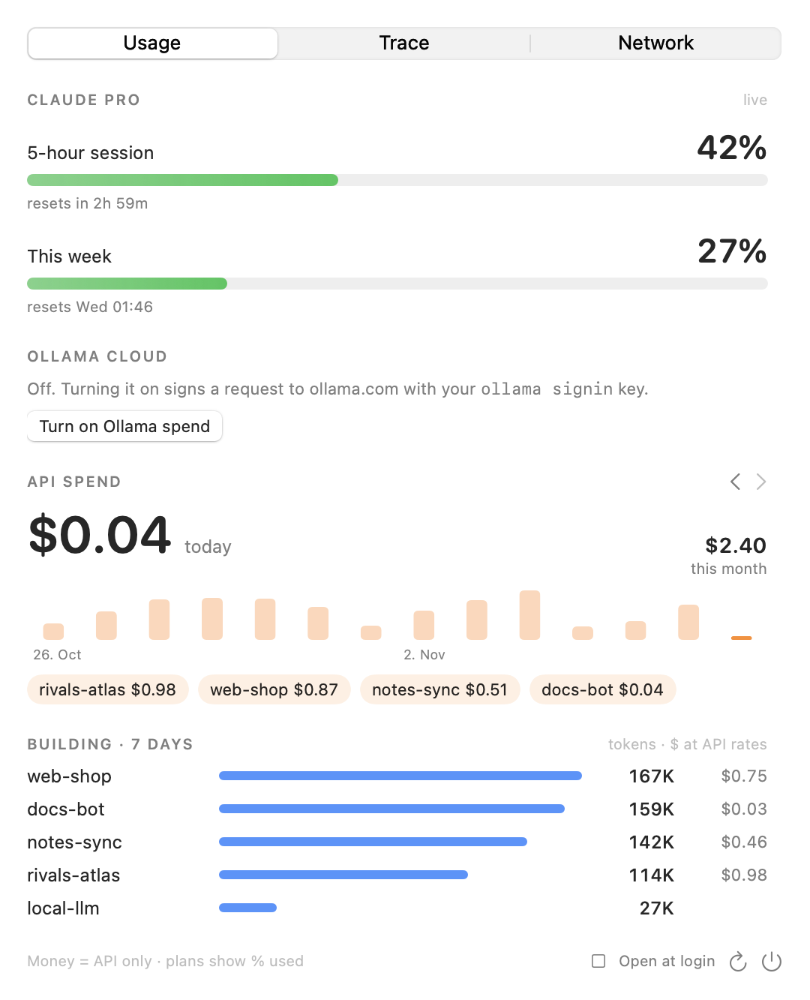

# AI Project Monitor

A macOS menu bar app for monitoring AI tooling on a Mac: model usage and cost, Claude Code sessions and tool calls, and network traffic per process. It is meant for tracking cost, usage and traffic across different projects in a personal toolkit.

<p align="center">
<picture>
<source media="(prefers-color-scheme: dark)" srcset="docs/popover-dark.png">

</picture>
</p>

## Features

The popover has three tabs.

- **Usage**: token counts and estimated API cost per project and per model, a daily and monthly spend chart, and Claude plan limits (5-hour session and weekly percentage). Optionally, Ollama cloud spend. Local models are counted as tokens only.
- **Trace**: Claude Code activity from its session logs. Tool calls in the last 24 hours with counts and failures, recent failures with the command or file involved, and recent sessions with duration, model calls, tool calls and failures.
- **Network**: outbound traffic per process, with open connections and remote hosts. AI-related processes are marked, and hosts that are not recognised are flagged. Hosts are resolved by reverse DNS, so entries are IP-level and not a full domain log.

## How it works

Usage comes from two sources:

1. **Claude Code.** Session logs in `~/.claude/projects` are read automatically. The project is the last folder of the working directory.
2. **The inbox.** Any other tool or application appends one JSON line per model call to a file in the inbox folder (see below).

Usage is stored in a local SQLite database, `~/Library/Application Support/aimon/aimon.db`. The Trace tab reads the same Claude Code logs. The Network tab samples `nettop` and `lsof` while the app runs.

## Requirements

- macOS 14 or later
- [Rust](https://rustup.rs)
- Swift toolchain (Xcode or the command line tools)

## Install

```
git clone <repository-url>
cd aimon
./build.sh        # builds the Rust core and the Swift app into AIMon.app
./install.sh      # installs a LaunchAgent: starts AI Monitor now and at login
```

`./uninstall.sh` stops AI Monitor and removes the LaunchAgent. The data folder is left in place.
Only one instance runs at a time; a second launch exits immediately.

## What AI Monitor reads and sends

- **Claude Code logs**: model name, token counts, timestamp and working folder of each call. Prompts and responses are not read.
- **Claude plan limits** (off by default): enable with the button in the popover or `aimon config claude_limits on`.
  When enabled, AI Monitor reads the Claude Code login token from the macOS Keychain and sends it to
  `api.anthropic.com/api/oauth/usage`, an undocumented endpoint that may change. macOS asks for permission to read the Keychain item;
  if it is refused or missing, AI Monitor does not ask again for a day. Disable with `aimon config claude_limits off`.
- **Ollama cloud spend** (off by default): enable with the button in the popover or `aimon config ollama on`.
  When enabled, and if `ollama signin` was run, AI Monitor signs a request to `ollama.com/api/usage` with the key in `~/.ollama/id_ed25519`.
  The key is used locally for signing and is not transmitted. This endpoint is also undocumented.
- **Network tab**: lists outbound connections per process using `nettop` and `lsof`. Nothing is sent anywhere.

Cost figures are estimates from a price list. The provider's invoice is authoritative.

## Reporting usage

Other tools and applications append one JSON line per model call to a file in `~/Library/Application Support/aimon/inbox/`:

```json
{"project":"my-app","model":"gpt-5","in":1200,"out":300,"cost":0.004}
```

- [docs/inbox.md](docs/inbox.md): fields, `aimon log`, folder grouping and prices
- [docs/proxy.md](docs/proxy.md): optional proxy for applications whose code cannot be changed (experimental)
- [docs/development.md](docs/development.md): checking totals and regenerating screenshots

## License

MIT. See `LICENSE`.
