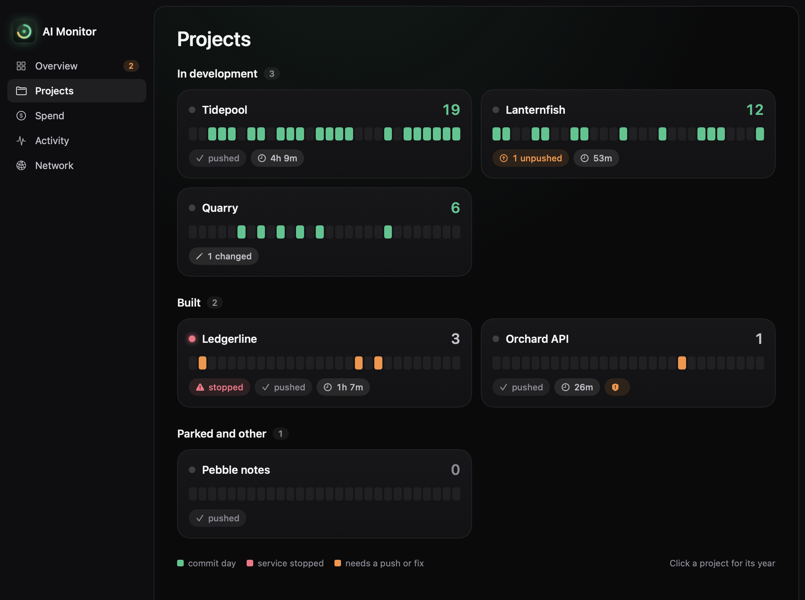

# AI Project Monitor

A macOS menu bar app that shows model usage and cost, Claude Code sessions and tool calls, network traffic per process, and the state of local project repositories.

<p align="center">


</p>

## Tabs

- **Spend**: tokens and estimated cost per project and model, plan limits.
- **Trace**: Claude Code tool calls, failures and sessions.
- **Network**: outbound connections per process and host.
- **Projects**: LaunchAgents, listening ports and unpushed work per repository (needs Backtrail).
- **Use**: when each project was last used (needs Backtrail).

Details: [docs/tabs.md](docs/tabs.md).

## How it works

- Claude Code session logs in `~/.claude/projects` supply usage. The project is the last folder of the working directory.
- Other tools append one JSON line per model call to the inbox folder (see below).
- Usage is stored in `~/Library/Application Support/aimon/aimon.db`.
- The Network tab samples `nettop` and `lsof` while the app runs.

## Requirements

- macOS 14 or later
- [Rust](https://rustup.rs)
- Swift toolchain (Xcode or the command line tools)

## Install

```
git clone <repository-url>
cd aimon
./build.sh        # builds AIMon.app
./install.sh      # installs a LaunchAgent that starts the app at login
```

`./uninstall.sh` removes the LaunchAgent and leaves the data folder. A second launch exits immediately.

## Data read and sent

- **Claude Code logs**: model, token counts, timestamp and working folder per call.
- **Plan limits** (off by default, `aimon config claude_limits on`): reads the Claude Code token from the macOS Keychain and sends it to `api.anthropic.com/api/oauth/usage`, an undocumented endpoint.
- **Ollama cloud spend** (off by default, `aimon config ollama on`): signs a request to `ollama.com/api/usage` with `~/.ollama/id_ed25519`. The key stays local.
- **Projects and Use tabs**: the Backtrail files in `~/Library/Application Support/Backtrail`, `git`, `launchctl`, `plutil`, `lsof`, `mdls` and `find`.

Cost figures are estimates from a price list.

## Reporting usage

Append one JSON line per model call to `~/Library/Application Support/aimon/inbox/`:

```json
{"project":"my-app","model":"gpt-5","in":1200,"out":300,"cost":0.004}
```

- [docs/inbox.md](docs/inbox.md): fields, `aimon log`, prices
- [docs/proxy.md](docs/proxy.md): proxy for applications whose code cannot be changed (experimental)
- [docs/security.md](docs/security.md): optional scan results shown in Projects
- [docs/development.md](docs/development.md): checking totals, regenerating screenshots
