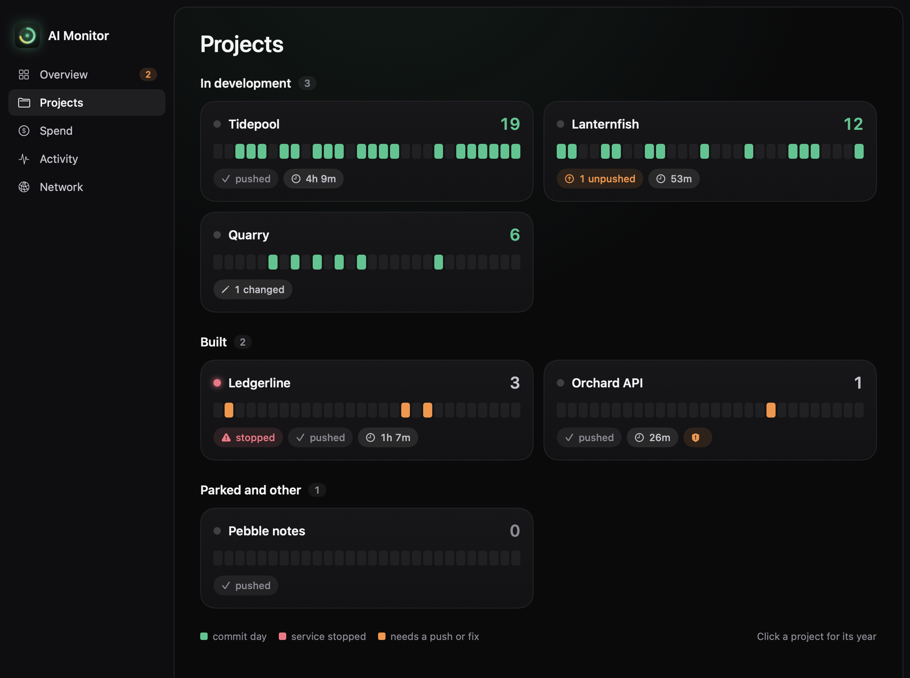

# Menu bar and window

The menu bar popover is the glance: a ring for the Claude plan's weekly use (API spend today when plan limits are off), cards for things to act on, and Open AI Monitor. A card appears for a stopped LaunchAgent, a plan limit at 85% or more, or a security finding. A click on a card opens the window at the page and project that shows it.

The window holds the history and the detail. It is dark, with a sidebar, and shows a Dock icon while open. Each number lives on one page; Overview's figures link to theirs.

## Overview

The plan ring, API spend this month, tokens in 7 days and failed tool calls in 24 hours, each a link to its page. Below, the attention cards and three cards for the last 8 weeks, from `aimon pace`:

- Agent works alone: the 90th percentile of run length, the time from a prompt to the agent's last reply before the next prompt, read from `~/.claude/projects`.
- Corrections: the share of user messages tagged as pushback in Backtrail's `turn_tags` table, filled by `skill/corrections.sh` in the Backtrail repository.
- Projects kept alive: repositories with commits on 5 or more days in the last 28.

## Projects

Every repository of a Backtrail thread that is not dropped, plus every other git repository at the top of the workspace, grouped as in development, built, and parked and other. A card shows the repository's commit days in the last 28 as a strip (orange below 5 days), its running service and port, push state, time in its app in the last 7 days and a shield for a security finding. A click opens one panel under the group: commit days, a year of commit days from git, time in its app, services, git state, stopped agents, the security finding and a year of days in its app.

Data sources:

- `config.json` and `backtrail.db` (read-only) in `~/Library/Application Support/Backtrail`. The `repos` map gives each repository's folder and thread; the thread state comes from the database.
- A LaunchAgent in `~/Library/LaunchAgents` belongs to a repository when its working directory or program is inside it. Agents with `KeepAlive` are counted; scheduled agents are idle most of the time.
- A listening port belongs to a repository when the working directory of its process is inside it. Processes of other users are not visible.
- Time in an app is stored in the `uses` and `spent` tables, at most once per project per 10 minutes, when an app bundle that belongs to the project becomes the active app, when the popover opens (for aimon itself), or when a tool runs `aimon use <repository folder|thread name> [--via web|cli]`. A bundle belongs to a project when it is inside the repository, when its name matches the repository folder, or when the `apps` map in `config.json` names it (`{"apps": {"Demo.app": "demo/demo-app"}}`).

## Spend

Claude plan limits (5-hour session and weekly percentage), API spend per day with earlier months, tokens per day over 14 days, 90 days or a year, the 7-day split by model, and tokens and estimated API cost per project for 7 days: the top 6, then the rest on request. A click on a project shows its tokens per day. Ollama cloud spend is optional. Local models are counted as tokens.

## Activity

Claude Code activity from its session logs: failed tool calls per day for 7 days, 90 days or a year, split into command exits, blocked calls and tool errors; the tool mix of the last 24 hours; and the sessions of the selected day. A click on a day selects it and lists its sessions, loaded on demand for days older than a week; a click on a session shows its model, tools and failures with the command or file involved.

## Network

Outbound traffic per process in 24 hours, 90 days or a year, as bars for bytes sent and received. Raw samples are dropped after 8 days; a per-process daily total in the `netday` table is kept for the longer ranges, and open connections show only on 24 hours. AI-related processes are marked, and processes with unrecognised hosts are orange. A click shows open connections and hosts. Hosts are resolved by reverse DNS, so entries are IP-level.

## Logs

Every LaunchAgent in `~/Library/LaunchAgents` that writes a log, as a tile: running, on a schedule or by hand, or stopped or failed, with its errors in the last 24 hours (consecutive error lines count once) and when it last wrote. A click shows the last 300 lines with a time for each, lines older than 24 hours dimmed, error lines marked, an errors-only switch and a button that opens the file in Console. The menu bar card for a stopped service opens its log.

Services write stdout and stderr to `~/Library/Logs/dev/<label>.log`, set in each project's install script. Apps print to stdout and stderr and need no logging setup of their own. On each refresh aimon copies a log over 5 MB to `<file>.1` and empties the original in place, so a running service keeps writing to the same file. aimon's own failed commands land in `dev.aimon.app.log`.

Most services print lines without a time. A line's time is the time it prints at its start (`2026-11-24 13:00:20` or ISO form) when present; otherwise it is when aimon first saw the file grow past that line, kept as offsets in the `logmark` table at each refresh (about 30 seconds). A line without its own time inherits the last printed time above it, which dates traceback lines. Lines written before aimon first read a file have no time and sit under a divider. A change of process id between lines shows as a restart.
